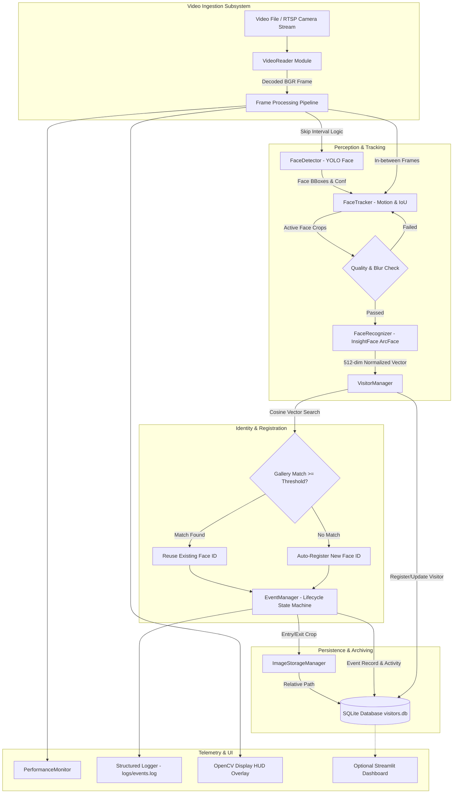
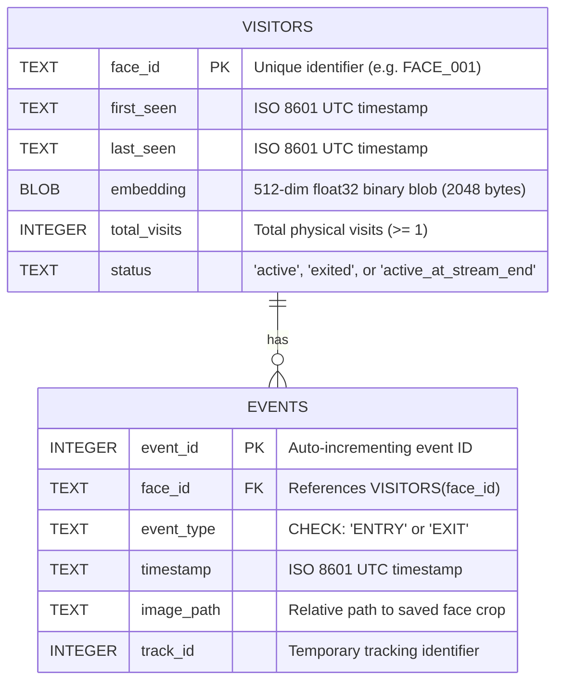

# System Architecture Specification
## Katomaran Intelligent Face Tracker with Auto-Registration and Visitor Counting

---

## 1. High-Level Architecture Overview

The system is constructed as a pipelined, decoupled event-driven architecture. The core pipeline coordinates frame ingestion, face localization, motion prediction, identity embedding extraction, visitor registration/re-identification, lifecycle event emission, image storage, and SQLite transactions.

---

## 2. Subsystem Components & Responsibilities

### 2.1 Video Ingestion (`src/video_reader.py`)
- Wraps `cv2.VideoCapture` with FFMPEG TCP backend for RTSP streams.
- Provides generator interface `frames()` yielding frame index and BGR array.
- Manages automatic reconnection with exponential backoff for live streams.
- Performs target resolution scaling to optimize downstream inference latency.

### 2.2 Face Detection (`src/face_detector.py`)
- Employs dedicated face-trained YOLO architectures (`yolov8n-face.pt`).
- Clips coordinates strictly to image boundary dimensions $[0, W] \times [0, H]$.
- Filters bounding boxes by confidence threshold ($\ge 0.50$) and minimum pixel area ($\ge 30 \text{ px}$).

### 2.3 Temporal Tracking (`src/face_tracker.py`)
- Maintains temporary track records across consecutive video frames.
- Uses a linear motion velocity model to predict next bounding box locations.
- Performs greedy bipartite matching over an Intersection-over-Union (IoU) cost matrix.
- Advances tracks seamlessly during skipped detection frames without losing identity.

### 2.4 Facial Recognition (`src/face_recognizer.py`)
- Runs ArcFace deep feature extraction (e.g. `buffalo_l` ResNet50 backbone).
- Applies Laplacian variance filtering to prevent blurry or occluded frames from corrupting biometric gallery records.
- Generates 512-dimensional float32 vectors L2-normalized to unit sphere length.

### 2.5 Visitor Management & Counting (`src/visitor_manager.py`)
- Maintains in-memory gallery cache for fast vector operations:
  $$\text{sim}(\mathbf{u}, \mathbf{v}) = \mathbf{u} \cdot \mathbf{v}$$
- Assigns sequential identifiers (`FACE_001`, `FACE_002`, ...).
- Guarantees that unique visitor count is strictly derived from persisted visitor records in SQLite.
- Re-identifies returning visitors across separate tracking sessions without incrementing the unique visitor count.

### 2.6 Lifecycle Event Management (`src/event_manager.py`)
- Implements the formal track state machine:
  $$\text{DETECTED} \longrightarrow \text{IDENTIFIED} \longrightarrow \text{ACTIVE} \longrightarrow \text{EXIT\_PENDING} \longrightarrow \text{EXITED}$$
- Enforces the strict invariant: **at most 1 ENTRY event and at most 1 EXIT event per confirmed visit**.
- Provides configurable disappearance grace period (`exit_grace_frames`) to tolerate brief occlusions without false exits.

### 2.7 Image Archiving (`src/image_storage.py`)
- Saves cropped face images in date-partitioned directories:
  - `logs/entries/YYYY-MM-DD/FACE_ID_YYYYMMDD_HHMMSS_microseconds.jpg`
  - `logs/exits/YYYY-MM-DD/FACE_ID_YYYYMMDD_HHMMSS_microseconds.jpg`
- Guarantees non-destructive naming and returns portable relative paths.

### 2.8 Database Schema (`src/database.py`)

