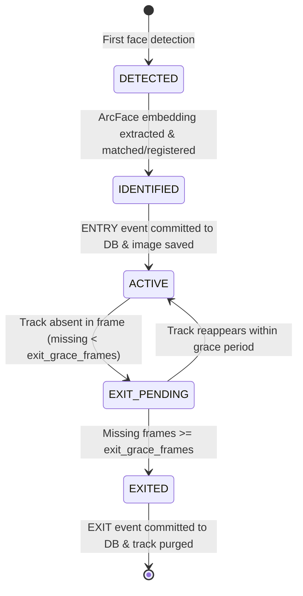

# AI Planning & System Design Document
## Katomaran Intelligent Face Tracker with Auto-Registration and Visitor Counting

---

## 1. Project Requirements Breakdown & Scope

The objective is an autonomous, production-ready computer vision application capable of processing either a local video file or a live RTSP IP camera stream to perform:
1. **Face-specific Detection**: Using YOLO models trained explicitly for human faces (e.g., `yolov8n-face.pt`).
2. **Facial Feature Representation**: Extracting 512-dimensional normalized embeddings via InsightFace / ArcFace.
3. **Temporal Tracking**: Maintaining track continuity across video frames using a motion-compensated IoU bipartite matching algorithm.
4. **Auto-Registration**: Registering previously unseen faces automatically with persistent, sequential `FACE_xxx` IDs.
5. **Re-Identification**: Matching returning visitors using cosine similarity and linking new track sessions to existing identities without inflating unique visitor counts.
6. **Lifecycle Event Management**: Emitting at most one `ENTRY` event and at most one `EXIT` event per confirmed presence lifecycle.
7. **Organized Image Archival**: Saving cropped face images in date-partitioned directories (`logs/entries/YYYY-MM-DD/` and `logs/exits/YYYY-MM-DD/`).
8. **Relational Persistence**: Storing visitors, timestamps, serialized embeddings, and event logs in SQLite with foreign keys.
9. **Structured Logging**: Continuous audit trail in `logs/events.log`.
10. **Telemetry & HUD**: Visualizing detections, track IDs, persistent Face IDs, and live metrics.

---

## 2. Architectural Design Decisions

### 2.1 Face Detection: Face-Specific YOLO vs. COCO YOLO
Standard COCO-trained YOLO models have a generic `person` class, which bounds the entire human body. For facial recognition, body crops require heavy secondary face cascades or fail completely under occlusion. We mandate a **face-specific YOLO** architecture (e.g., `yolov8n-face`) trained on WiderFace or similar benchmarks, yielding tight facial bounding boxes and landmarks.

### 2.2 Facial Recognition: InsightFace / ArcFace (Cosine Similarity)
ArcFace (Additive Angular Margin Loss) maps face crops into a hypersphere where angular distance corresponds directly to facial identity. By L2-normalizing embeddings:
$$\text{sim}(\mathbf{u}, \mathbf{v}) = \frac{\mathbf{u} \cdot \mathbf{v}}{\|\mathbf{u}\|_2 \|\mathbf{v}\|_2} = \mathbf{u} \cdot \mathbf{v}$$
This enables vector operations that execute in sub-millisecond time even with hundreds of gallery visitors. A configurable matching threshold (default 0.45) balances False Match Rate (FMR) and False Non-Match Rate (FNMR).

### 2.3 Decoupling Track IDs from Persistent Face IDs
A major pitfall in naive counting systems is treating tracking IDs as person IDs. If a person turns away or leaves the camera view, their tracking ID is lost. When they return, a new track ID is spawned.
- **`track_id`**: Ephemeral integer assigned by the local multi-object tracker for an uninterrupted visual trajectory.
- **`face_id`**: Persistent global identity stored in SQLite (`FACE_001`, `FACE_002`).
When a new track is observed, the system extracts its embedding and queries the persistent gallery. If matched, the existing `face_id` is assigned to the new `track_id`.

### 2.4 Track Lifecycle State Machine
To guarantee at most one `ENTRY` and one `EXIT` event per physical visit:

### 2.5 Relational Persistence: SQLite with WAL Mode
SQLite is selected for self-contained, zero-dependency deployment. Write-Ahead Logging (`PRAGMA journal_mode = WAL;`) and immediate transactions ensure ACID compliance and multi-threaded read concurrency. Embeddings are stored as raw binary float32 blobs (`serialize_embedding`) validated against NaN/Inf corruption.

---

## 3. Development Phases

- **Phase A**: Environment inspection, directory creation, Python 3.10 virtual environment setup.
- **Phase B**: Implementation of configuration system, logging, database persistence, and image storage.
- **Phase C**: Face detection module with YOLO face weights and boundary clipping.
- **Phase D**: Face recognizer with InsightFace / ArcFace and quality validation.
- **Phase E**: Multi-face tracker with motion compensation and IoU bipartite matching.
- **Phase F**: Visitor manager and lifecycle event manager.
- **Phase G**: Main pipeline orchestration with OpenCV HUD display and CLI overrides.
- **Phase H**: Automated test suite covering all modules with pytest.
- **Phase I**: Integration verification and sample video processing.
- **Phase J**: Documentation, performance profiling, and submission packaging.

---

## 4. Hardware Constraints & Portability Assumptions

1. **CPU Feasibility**: Many edge cameras or evaluation environments lack dedicated NVIDIA GPUs. The pipeline includes frame resizing (`frame_resize_width: 960`) and detection skipping (`detection_skip_frames: 3`) to sustain 25-30 FPS on multi-core modern CPUs.
2. **Cross-Platform Compatibility**: File paths stored in the database and logs use relative forward-slash paths (`logs/entries/...`) to ensure seamless database portability between Windows and Linux.
3. **Resilience to Stream Interruptions**: Live RTSP camera streams inevitably experience packet loss or socket resets. The video reader includes exponential backoff reconnection.

---

## 5. Failure-Handling Strategy

| Failure Mode | Root Cause | System Mitigation |
| :--- | :--- | :--- |
| **Model Weights Missing** | First run without downloaded weights | Automated download helper or descriptive error message with direct official URLs. |
| **RTSP Connection Drop** | Network jitter or camera reboot | Reconnection loop with configurable attempts and interval without crashing main process. |
| **Blurry / Tiny Face Crop** | Motion blur or far-field distance | Laplacian variance check and minimum resolution filter reject low-quality crops before embedding. |
| **Database Lock Contention** | Concurrent read/write | Immediate transactions with 30s timeout and WAL mode. |
| **Image Write Failure** | Filesystem permission or disk full | Fallback placeholder path recorded with error log; database transaction consistency preserved. |
